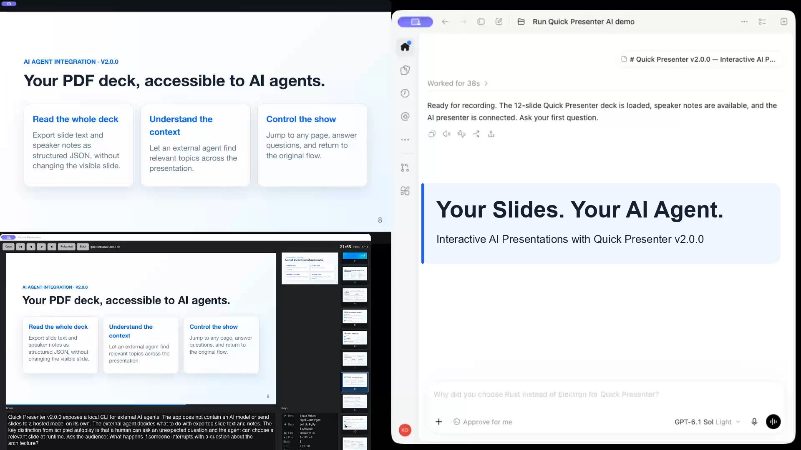
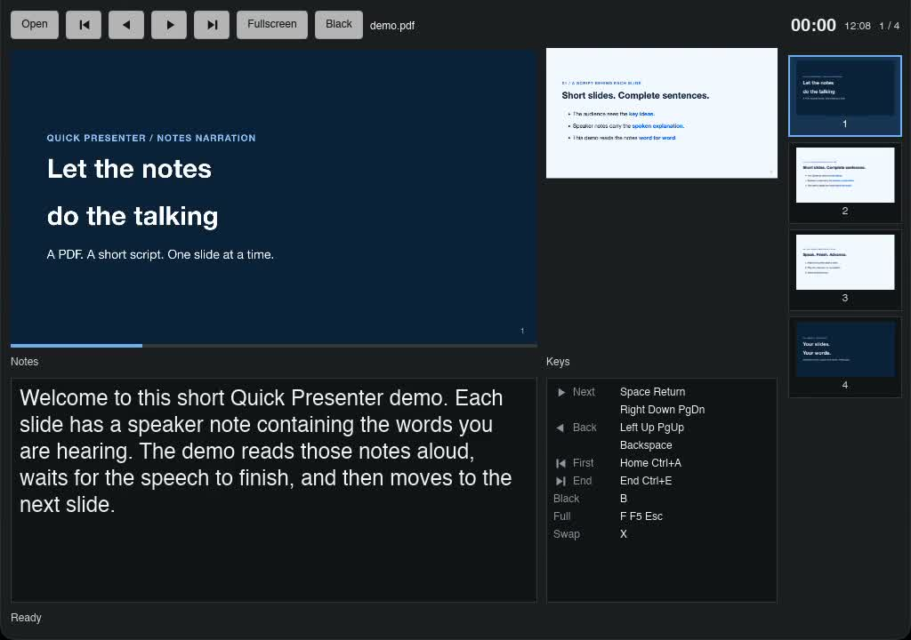
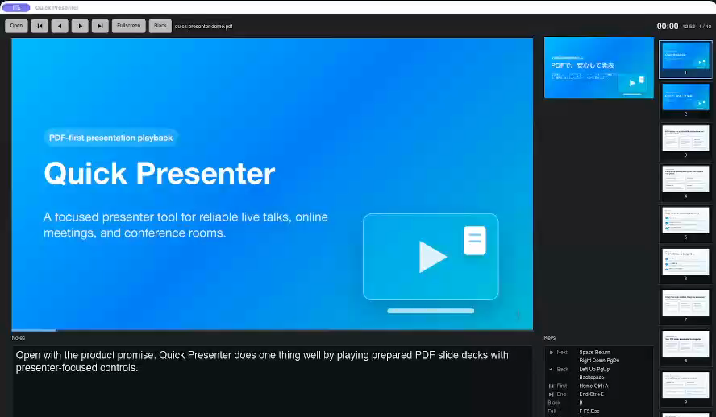
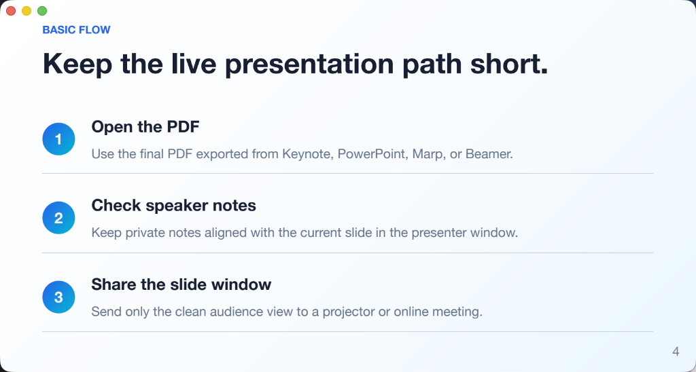
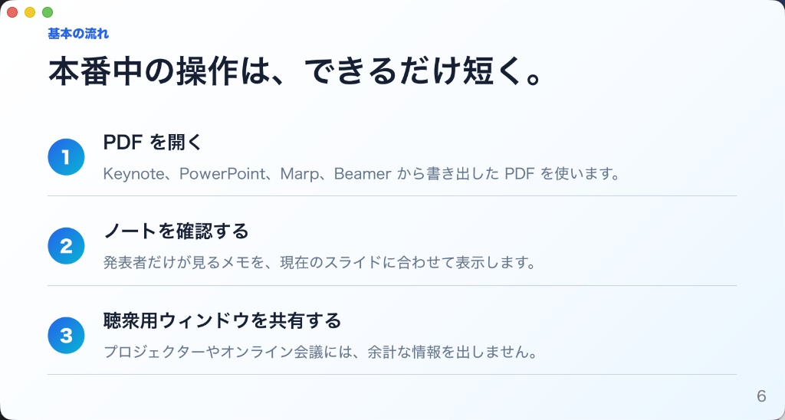

# Quick Presenter

[Website](https://quickpresenter.com/) ·
[Downloads](https://github.com/koichiro/quick-presenter/releases) ·
[CLI reference](https://github.com/koichiro/quick-presenter/blob/v2.0.0/docs/CLI.md) ·
[Changelog](CHANGELOG.md) ·
[Privacy](https://quickpresenter.com/privacy/)


[](LICENSE)


**Your PDF slides. Your AI agent. New possibilities.**

Quick Presenter is a cross-platform PDF presentation app built with Rust,
Slint, and PDFium. Version 2.0 adds `qp`, a stable local CLI that gives scripts
and external AI agents access to slide text, speaker notes, presentation state,
and playback controls.

Use the same prepared PDF for a conventional talk, an interactive agent, or a
workflow you build yourself. Quick Presenter owns PDF display and presentation
state. Your external tools interpret the material, generate answers or audio,
and decide which operations to request. The app does not bundle an AI model
or TTS engine.

## Start with the CLI

Install Quick Presenter v2.0.0 and use the GUI and CLI from the same package.
See [downloads](https://quickpresenter.com/#download) and
[CLI installation](https://github.com/koichiro/quick-presenter/blob/v2.0.0/docs/CLI.md#installation)
for package paths and PATH setup. macOS automation requires the Developer ID /
DMG distribution; Mac App Store control is unsupported in v2.0.0. Windows
Store v2.0.0 is coming soon and will provide the `qp.exe` execution alias;
Debian installs `/usr/bin/qp`. Use the macOS DMG or Debian package to try the
released version now.

From the repository root, open the checked-in notes-bearing sample:

```sh
qp --version --json
qp open website/src/assets/interactive-ai-sample.pdf --json
qp status --json
```

Wait for `opening: false`, `render_state: "ready"`, and
`notes_state: "ready"`. Then read the deck and try the controls:

```sh
# Read all pages without changing the displayed slide
qp export --json > deck-context.json

# Read current and next page context
qp context --full --json

# Choose a page (one-based syntax example), then advance
qp goto 3 --json
qp next --json

# Check state and observe subsequent changes; stop watch with Ctrl-C
qp status --json
qp watch --json
```

`qp open` can start the companion GUI if it is not running. The other commands
require a running GUI; content queries also require an open PDF.

## Build on the presentation interface

| Capability | What your tool can do | Commands |
| --- | --- | --- |
| Read | Export every page's full text and speaker notes without navigating; query current and next page context. | `qp export --json`, `qp context --full --json` |
| Control | Open a PDF, select a one-based page, or advance explicitly. | `qp open deck.pdf --json`, `qp goto 3 --json`, `qp next --json` |
| Observe | Query presentation state and stream changes as NDJSON. | `qp status --json`, `qp watch --json` |

The interface uses Control Protocol v1. Application versions and protocol
versions are independent. Parse JSON fields and error codes rather than
human-readable output, and accept additional object fields.

- `export` returns one JSON array. Each entry's `current.page`, `current.text`,
  and `current.notes` describe the exported page. `presentation.page` is the
  live page at the start of export. The default omits `next`; use
  `--include-next` if your consumer needs that field.
- Other one-shot JSON commands return one object. `watch --json` emits one
  independently valid event per line; it does not acknowledge render or note
  readiness. Query `status` for those states.
- Text extraction does not include images, diagram interpretation, or OCR.
  Image-only pages can have `text: []`; pages without notes have `notes: ""`.
  Ordinary PDF export does not guarantee extractable speaker notes.
- Check exit codes and JSON errors on stderr. `NOTES_LOADING` means wait for
  notes readiness and retry the read. After a timeout or disconnection, query
  status before retrying a mutation whose outcome may be uncertain.

Connect a local model, hosted service, or script through the CLI integration
you configure. Quick Presenter provides the source information and controls;
your integration determines what to do with them. The two demos below are
examples, not the limits of the interface or a guarantee of compatibility
with every agent.

See the [CLI reference](https://github.com/koichiro/quick-presenter/blob/v2.0.0/docs/CLI.md),
[protocol contract](https://github.com/koichiro/quick-presenter/blob/v2.0.0/docs/CONTROL_PROTOCOL.md),
and [export JSON Schema](https://github.com/koichiro/quick-presenter/blob/v2.0.0/docs/schemas/qp-export.schema.json)
for the complete contract and limits.

## Two integration examples

### Interactive AI Presenter

Codex reads text and speaker notes from the whole deck using `qp export --json`.
Ask a question in natural language; the external agent uses the deck to answer
and selects a related page when useful. It returns to the saved presentation
position when you ask. Quick Presenter supplies PDF display, context, state,
and controls; the external agent interprets the material and makes decisions.

[](https://quickpresenter.com/#agentic-presentation)

[Watch the short demo (29 seconds, no audio)](https://quickpresenter.com/#agentic-presentation)
· [Short MP4](website/src/assets/interactive-ai-short.mp4)
· [Full demo (76 seconds, no audio)](website/src/assets/agentic-presentation-demo.mp4)
· [Prompt and reproduction guide](docs/INTERACTIVE_AI_PRESENTER.md)
· [Sample PDF with notes](website/src/assets/interactive-ai-sample.pdf)

Integration pattern: export the deck once, save the current session/document
identity and page, then choose controls based on the question. Restore the
saved page only on request, after checking that the same document is open.
The short recording edits processing waits; it is not a latency benchmark.

### Autopilot

An external Python runner reads prepared speaker notes aloud with optional
[Kokoro](https://github.com/hexgrad/kokoro) TTS and advances after playback.
It waits for rendering, note readiness, and audio completion, stopping on
failure. Quick Presenter provides PDF context and presentation controls.

[](https://quickpresenter.com/#autopilot)

[Watch Autopilot (72 seconds, English narration)](https://quickpresenter.com/#autopilot)
· [MP4](website/src/assets/kokoro-demo.mp4)
· [Runner and Kokoro setup](https://github.com/koichiro/quick-presenter/blob/v2.0.0/examples/autopresent/README.md)

Integration pattern: read the current note, hand it to an external player,
wait for playback completion, and only then request `qp next --json`. The
Kokoro adapter synthesizes a complete WAV before playback and caches it for
reuse. Its setup and model download are separate from Quick Presenter.

## Presenter and audience views

Quick Presenter also works without an agent. The presenter window keeps slide
context and controls together; the audience window shows only the deck.

<details>
<summary>View macOS screenshots</summary>

### Presenter Window



### Slide Window






The screenshots use the repository-owned sample deck in
[docs/samples/quick-presenter-demo.md](docs/samples/quick-presenter-demo.md).

</details>

## Reliable PDF playback

Many speakers create slides in a separate authoring tool, then export the final
deck to PDF. PDF is stable and portable, but ordinary PDF viewers are not
designed around live presentation workflows.

Quick Presenter provides a focused playback experience:

- A presenter window with the current slide, next slide preview, speaker notes,
  elapsed time, clock, and page status.
- A separate slide window for audience-facing output.
- Keyboard-first navigation that works well with presentation remotes.
- A compact PDF-only workflow that avoids editor complexity during a talk.

The goal is to make presenting a prepared PDF feel predictable, especially when
switching between in-person talks, conference rooms, and online meetings.

## PDF Authoring Tools

Quick Presenter does not create or edit slide decks. It presents PDF files
exported from authoring tools such as:

| Tool | Notes |
| --- | --- |
| Keynote | Export the finished deck to PDF before presenting. |
| PowerPoint | Export the finished deck to PDF before presenting. |
| Google Slides | Export the finished deck to PDF before presenting. |
| [Marp](https://marp.app/) | OSS Markdown-based slide authoring; exported PDF speaker notes are supported in the presenter window. |
| [LaTeX Beamer](https://ctan.org/pkg/beamer) | OSS LaTeX class for PDF-first slide decks; `pdfcomment` annotations can provide speaker notes in the presenter window. |

The supported input remains the exported PDF, not the source project from any
authoring tool. Representative exports from these tools are covered by the
[PDF export compatibility fixtures](docs/PDF_COMPATIBILITY.md).

### Marp speaker notes

Write notes in Markdown comments and preserve their PDF annotations when
exporting:

```sh
marp --no-config --pdf --pdf-notes talk.md --output talk.pdf
```

Check the resulting notes in Quick Presenter or through the CLI before the talk.
The [interactive sample](website/src/assets/interactive-ai-sample.pdf) and
[Autopilot sample](website/src/assets/autopilot-sample.pdf) include notes.
See the [Autopilot setup guide](https://github.com/koichiro/quick-presenter/blob/v2.0.0/examples/autopresent/README.md)
for the sample source, exact export command, and optional TTS dependencies.

### Beamer speaker notes

Beamer's native `\note` command typesets separate note pages or a second-screen
layout; it does not store notes as metadata on the original slide page. To make
the same note available to Quick Presenter, add a transparent PDF `Text`
annotation with the [`pdfcomment`](https://ctan.org/pkg/pdfcomment) package:

```tex
\usepackage{pdfcomment}

\newcommand{\presenternote}[1]{%
  \note{#1}%
  \pdfcomment[icon=Note,opacity=0,author={Quick Presenter}]{#1}%
}
```

Use `\presenternote` inside a frame in place of `\note`:

```tex
\begin{frame}{Example}
  Slide content.
  \presenternote{Explain the important point on this slide.}
\end{frame}
```

Quick Presenter reads the annotation text into the presenter window and does
not render its icon onto the audience slide. A tested source and generated PDF
are available in
[`tests/fixtures/latex-beamer.tex`](tests/fixtures/latex-beamer.tex) and the
[PDF compatibility notes](docs/PDF_COMPATIBILITY.md).

## Current Capabilities

- Open prepared PDF slide decks from the UI or at startup.
- Automatically reload the active PDF after a valid external file change while
  keeping the last good version visible during incomplete or failed saves.
- Present with separate speaker-facing and audience-facing windows.
- Keep presenter context visible through page status, next-slide preview,
  speaker notes, timer, and clock.
- Support keyboard-first navigation, including common presenter remote keys.
- Bundle the PDF runtime in packaged builds for predictable playback.
- Expose full-deck text/notes, page context, state, navigation, and change events
  through the v2.0.0 CLI for external integrations.

## Basic Usage

Run the app:

```sh
cargo run --bin quick-presenter
```

On orderly exit, Quick Presenter remembers the active PDF and the slide window's
normal size and position. The next launch reopens that PDF at its first page in
windowed mode. An explicit startup PDF takes precedence. Missing or inaccessible
PDFs leave the app open so you can select another file. Display changes use an
available-screen fallback; Wayland leaves window placement to the compositor.

Headless and GUI smoke modes bypass this restoration and never read or save the
startup record. See [startup restoration](docs/SLIDE_WINDOW_PLACEMENT.md) and
[privacy and reset instructions](docs/PRIVACY.md).

Open a PDF at startup:

```sh
cargo run --bin quick-presenter -- --pdf path/to/slides.pdf
```

For development verification, this repository includes a small fixture PDF:

```sh
cargo run --bin quick-presenter -- --pdf tests/fixtures/marp-speaker-notes.pdf
```

The README screenshot deck can also be opened directly:

```sh
cargo run --bin quick-presenter -- --pdf docs/samples/quick-presenter-demo.pdf
```

The active PDF is watched automatically. Saving it in place or replacing it
atomically refreshes the deck while preserving the current page when possible.
No hot reload setting is required.

The Cargo package and GUI executable are both named `quick-presenter`.
The automation executable is `qp`; see the
[v2.0.0 CLI reference](https://github.com/koichiro/quick-presenter/blob/v2.0.0/docs/CLI.md).

Keyboard controls are documented in [docs/KEYBOARD.md](docs/KEYBOARD.md).
Recent-file privacy behavior is documented in
[docs/PRIVACY.md](docs/PRIVACY.md).
Packaged app diagnostic logs are documented in
[docs/PACKAGING.md](docs/PACKAGING.md#diagnostic-logs).

## Build and Development

Install Rust stable and Python 3, then fetch the local PDFium binary used for
development:

```sh
python3 scripts/fetch_pdfium.py
```

CI and release packaging fetch PDFium with `--clean` so extraction starts from a
clean output directory. See [docs/PACKAGING.md](docs/PACKAGING.md) for the
release-oriented PDFium fetch requirements.

Build the GUI and CLI:

```sh
cargo build --bins
```

For development CLI examples, replace `qp` with `./target/debug/qp` (or
`target/debug/qp.exe` on Windows). Keep the companion GUI binary alongside it.

### Core components

- Rust owns application state, PDF loading, rendering requests, caching, IO,
  and error handling.
- [PDFium](https://pdfium.googlesource.com/pdfium/), accessed through
  [`pdfium-render`](https://crates.io/crates/pdfium-render), parses and renders PDFs.
- [Slint](https://slint.dev/) handles layout and user events.

Keep state transitions and PDF operations in Rust. See
[architecture](docs/ARCHITECTURE.md) and [repository conventions](AGENTS.md)
when changing these boundaries.

### Validation

Run the standard checks:

```sh
cargo fmt --check
cargo check
cargo test
```

Run the dependency advisory audit before release validation:

```sh
scripts/audit_deps.sh
```

Coverage is measured with:

```sh
scripts/coverage.sh
```

Detailed packaging, release, keyboard, and speaker-note behavior is documented
under [docs/](docs/).

Source statistics are reported with (requires `cloc`; `brew install cloc` on macOS):

```sh
python3 scripts/stats.py
python3 scripts/stats.py --ref origin/main
```

## Releases

Quick Presenter is an OSS project focused on reliable PDF presentation
playback and external automation. Windows is distributed through Microsoft Store;
the signed/notarized macOS package and Linux package are published through
GitHub Releases. Download and launch steps are documented in
[docs/RELEASE.md](docs/RELEASE.md).

Packaging and signing details for maintainers are documented in
[docs/PACKAGING.md](docs/PACKAGING.md).

Mac App Store CLI development targets the
[`v2.5.0` branch](https://github.com/koichiro/quick-presenter/tree/v2.5.0)
and [v2.5.0 milestone](https://github.com/koichiro/quick-presenter/milestone/4),
renamed from v2.4.0. The scope and signed-runtime acceptance gates remain
tracked in [#422](https://github.com/koichiro/quick-presenter/issues/422) and
#431–#433. Store CLI support remains outside v2.0.0.

## Development priorities

Version 2.0 opens presentation information and controls to external tools while
keeping reliable PDF playback central. Contributions should preserve predictable
rendering, navigation, error recovery, and platform behavior. Extend integrations
through the documented CLI contract and keep editing, model inference, and
speech orchestration outside the playback core.

## Related Projects

- [Présentation.app](https://iihm.imag.fr/blanch/software/osx-presentation/) is
  a similar PDF presentation tool for macOS.

## Contributing

Contributions are welcome.

Before starting broad changes, please open or join an issue so the scope can
stay clear. Quick Presenter prioritizes predictable live presentation behavior,
so changes should keep PDF playback reliable and avoid turning the app into a
slide editor.

Useful starting points:

- Read [AGENTS.md](AGENTS.md) for repository conventions.
- Read the architecture notes in [docs/ARCHITECTURE.md](docs/ARCHITECTURE.md).
- For integrations, read the [v2.0.0 CLI contract](https://github.com/koichiro/quick-presenter/blob/v2.0.0/docs/CLI.md)
  and [interactive presenter guide](docs/INTERACTIVE_AI_PRESENTER.md).
- Read the current and target PDFium trust boundaries in
  [docs/PDF_RENDERING_SECURITY.md](docs/PDF_RENDERING_SECURITY.md).
- Check keyboard behavior in [docs/KEYBOARD.md](docs/KEYBOARD.md).
- Check speaker-note behavior in [docs/NOTES.md](docs/NOTES.md).
- Run `cargo fmt --check`, `cargo check`, and `cargo test` before submitting a
  pull request.

## License

Quick Presenter is licensed under the GNU General Public License v3.0 only.
See [LICENSE](LICENSE).

Paid distribution is allowed under the GPL, but every binary distribution must
preserve the recipient's GPL freedoms and provide the corresponding source code
for that exact build.

Quick Presenter uses PDFium through `pdfium-render`. Packaged builds that bundle
PDFium must include PDFium and third-party component license files. See
the fetched runtime's `pdfium/LICENSE` and [docs/PACKAGING.md](docs/PACKAGING.md).
