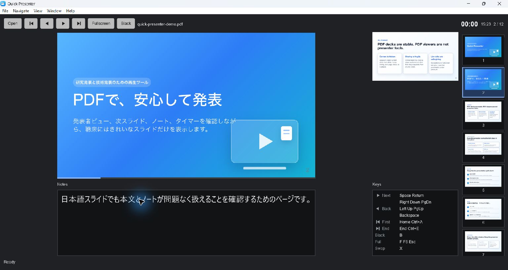

# Windows notes-focus navigation — 2026-10-21

## Baseline and scope

- Windows x64 25H2, build 26200.9711.
- Baseline: main `430cef0` (v2.5.0 merge). Baseline dev executable SHA-256:
  `2e6988fedc98913aad5e33912376bca7642b7d594dd7a20b21d3b1c7b8e82454`.
- Fixture: `docs/samples/quick-presenter-demo.pdf` (12 pages, English/Japanese notes).
- Existing PDFium 156.0.8076.0. Isolated APPDATA/LOCALAPPDATA; normal user settings untouched.
- All input described here is injected native input through Computer Use, not a physical keyboard. No Narrator-enabled or distribution-artifact qualification is claimed.

## Reproduction and cause

After directly clicking the note body on page 2, UI Automation reported the notes edit as focused and Right left the page at 2/12. Return then advanced to 3/12 in this run. The older Return failure remains a distinct historical observation, not a reproduced failure on this baseline. An accessibility-element click alone had initially advanced with Right; the reproduction required a direct pointer click into the actual text body. Focus metadata alone was insufficient evidence of the key-dispatch path.

Slint 1.18.1 `TextInput::key_event` calls the application's key-pressed callback first. Returning Reject continues built-in handling, including read-only cursor movement, which accepts arrow/Home/End keys. Parent FocusScope KeyBindings run during bubbling and therefore do not see those accepted events. The notes previously returned Reject unconditionally.

The fix forwards note key presses into Rust before built-in handling, accepts only recognized navigation keys and calls the existing shared presentation-command handler. Shift-modified selection and normal select-all/copy remain with TextInput. Ctrl+A selects the focused paragraph; Home is the first-page shortcut in that state. Ctrl+E keeps the documented last-page shortcut, with the existing physical-Control mapping on macOS. Toolbar bindings and window-wide dispatch are unchanged; macOS toolbar work is separate.

## Validation status

Runtime fix: `e3bebfb`; test-only initialization follow-up: `78f7195`. Tested dev executable SHA-256: `16953feca13de4abf590bf7b7021e96d898103b131f59e17456e6a190f208883`. This is a source-built development executable, not a signed Store/MSIX artifact.

Each navigation row below started after a fresh pointer click into the visible notes, except Left, which started with a selection still active in the already-focused notes. Page labels were read from fresh native UI state; rendered pages were also inspected.

| Notes key | Observed page transition |
| --- | --- |
| Right | 1 → 2 |
| Return | 2 → 3 |
| Down | 3 → 4 |
| Up | 4 → 3 |
| Home | 3 → 1 |
| End | 1 → 12 |
| Left (selection active) | 12 → 11 |
| Page Up | 11 → 10 |
| Page Down | 10 → 11 |
| Backspace | 11 → 10 |
| Space | 10 → 11 |
| Ctrl+E | 11 → 12 |

On page 12, Ctrl+A selected the complete focused note paragraph without changing the page. Ctrl+C copied it; pasting into the standard file picker's filename field reproduced the exact synthetic note text. The picker was cancelled without opening a file. Shift+Left shortened the selection by one character while the page stayed at 12. Tab reached the standard Open toolbar button and Space opened its picker. Slide-window Home returned to page 1 and Return advanced to page 2; the presenter then also showed 2/12. Both windows exited normally afterward. Toolbar Return activation, Narrator-enabled operation and physical-key tests remain unexecuted.

`cargo fmt --check` and `cargo check --locked` passed. Both new input regression tests and all 415 main-module unit tests passed. A first full run overlapped the native GUI launch and failed an IPC bind with access denied; after the GUI was closed the same IPC executable test and all five Windows IPC tests passed. The repeated full 8076 run passed input, IPC and startup tests but returned exit 101: 13/14 renderer-process tests passed, while `restart_is_bounded_malformed_responses_are_not_retried_and_later_pdf_recovers` hit `operation=Handshake cause=Timeout` for `abort-on-render`. Its fixture requests a 1,000 ms helper deadline. A single isolated rerun without any GUI passed (1 passed, 13 filtered; 129.77 s). No timeout or assertion was weakened. This records the full-run failure and successful isolated retry separately; it is not a clean full-suite pass. No coverage run was requested.

## Windows dependency review for #480

On the same lockfile, `cargo tree --locked --target <target> --all-features -i <crate> --edges normal,build` prints no active path for either bincode or ttf-parser on both `x86_64-pc-windows-msvc` and `i686-pc-windows-msvc`. Windows x64 default-feature normal/build queries also print no path. These are resolved dependency-tree observations, not binary composition analysis or a claim of safety on every target/configuration. No advisory ignores or dependency pins were changed.

The official PDFium `chromium/8111` release was published 2026-10-19T18:30:12Z. Its Windows x64 archive matched the official SHA-256 `3452d11031050ec65e57f180215b57b9e6d465e3fbedafa8a77ad90885c7d23e`. The candidate's top-level LICENSE matched the existing 8076 file (SHA-256 `8854f4388f1ca13b3ad9baa42e95f5546b4c0b17109c159256d3eca7be39b09b`). The candidate is isolated under ignored artifacts; this PR does not update the distributed manifest or claim complete license/security review or all-platform qualification.

With `PDFIUM_DYNAMIC_LIB_PATH` pointing to the isolated 8111 DLL, `cargo test --locked -- --test-threads=1` passed the complete suite (exit 0), including all 415 main-module unit tests, all 14 renderer-process tests, Windows IPC/startup tests, slide layout and doctests. Renderer-process tests completed in 308.88 s. The 8076 full-run timeout above remains separately disclosed; no test deadlines were changed for the candidate run.

The same development GUI executable then opened the 12-page demo with 8111. The English page/notes rendered, a direct click into notes followed by Right advanced 1 → 2, and the Japanese page/notes plus next preview rendered with Ready status. The loaded helper's `pdfium.dll` hash matched the isolated candidate DLL (`a318c39c137482dc4687c2973b7ec1c27fc1c20253cf2dc31928f922eab89e8f`), confirming the candidate was actually loaded. The GUI exited normally. This is Windows x64 development-binary compatibility evidence only; no signed distribution or Windows x86 execution was tested. It does not establish CVE affectedness, fix inclusion, or release readiness.

