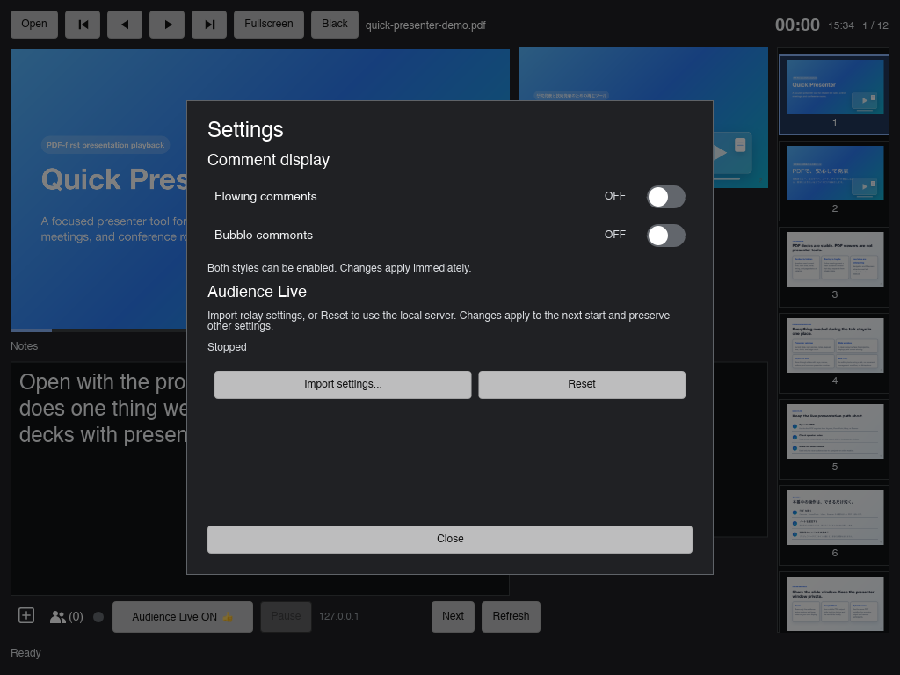

# v3.0.0 comment bubbles — 2026-10-25

Base: `a6eab96` on `v3.0.0`. Local macOS arm64 debug validation.

## Passed checks

- `cargo fmt --check`, `cargo check`, `cargo build --bins`, and the final
  complete `cargo test` pass. Two existing tests remain ignored; the existing
  `macos_renderer.rs` `fetch_update` deprecation warning remains.
- Unit tests cover every flowing/bubble combination, admission/generation and
  duplicate suppression, anonymous names, bounded bursts, upward motion,
  idle timer termination, pause/reset, and preference persistence across relay
  import/reset.
- Developer ID-signed local debug `.app` passes signature verification and the
  XPC PDF render/notes plus private-file/network/child denial gate.
- Normal-launch native UI checks confirm translucent rounded gray cards,
  Japanese wrapping, small author labels, anonymous label omission,
  simultaneous flowing/bubble output, independent settings, and saved
  bubble-only preferences restored after restarting the app.
- The final native app preserves three bubbles while moving from page 0 to the
  PDF. Posting a fourth and fifth comment leaves the newest four in order,
  with the oldest removed and the newest at the bottom. The slide title remains
  visible through the cards. Test sessions were stopped and apps exited.

## Limits and unsuccessful attempts

The sandboxed test attempt could not bind local sockets. Host tests passed.
An intermediate full rerun timed out in the existing
`restart_is_bounded_malformed_responses_are_not_retried_and_later_pdf_recovers`
renderer integration test while GUI validation was also running. The final
complete rerun passed.

Before desktop unlock, full macOS GUI smoke stopped at rapid fullscreen-entry
cancellation: `notifications=[1, 0, 0, 0]` without completion. No native
notification assertions were relaxed.

## Unlocked desktop rerun and screenshots

After desktop unlock, the full signed-app GUI suite reached **229 passes**,
including all comment assertions on both an empty deck and a loaded PDF. It
then stopped in the later hidden-window fullscreen check:
`hidden-window fullscreen=true did not complete`, with notification counts
`[5, 5, 5, 5] -> [6, 5, 5, 5]`. Full GUI qualification remains incomplete.
Subsequent full-suite retries also reproduced the early native fullscreen
notification timeout.

A separately identified focused run against `docs/samples/quick-presenter-demo.pdf`
passed **117 checks, zero failures**. It covers Audience Live start/stop, real
loopback WebSocket comments/reactions, both comment styles together, bubble-only
mode, author separation, pause/resume and generation handling, both styles OFF,
page-0 continuity, four-card burst bounds/ordering, panel layout, and Settings.
It does not run or claim to pass native fullscreen checks.

The optional `QP_GUI_SMOKE_SCOPE=comments` selects this focused scope; leaving
it unset retains the full suite. `QP_GUI_SMOKE_BUBBLES_SNAPSHOT=/tmp/comments.ppm`
saves separate PPM snapshots for combined/two-bubble/five-bubble stages, with
`pdf` or `no-deck` in each filename. The existing
`QP_GUI_SMOKE_SETTINGS_SNAPSHOT` saves the Settings view.

### Right-aligned compact revision

The cards now anchor to the Audience window's right edge, including when the
window and slide aspect ratios differ. Width is one third of the window;
height is reduced from 144 to 120 logical pixels. Background opacity is reduced
from about 70% to 50%, while text remains opaque. The four-card stack uses
132-pixel slots and clips outgoing cards above its top edge.

Formatting, `cargo check`, `cargo build --bins`, and the complete `cargo test`
pass after the revision (622 passed, two existing ignored tests).
The revised signed app passes the focused Audience Live/comments run again:
**117 checks, zero failures**. The combined, two-card, and four-card screenshots
below were recaptured from that run on the demo PDF and visually reviewed for
right alignment, reduced footprint, and slide visibility through the cards.
The Settings screenshot is unchanged. This revision does not rerun or claim to
resolve the full-suite macOS fullscreen timeout recorded above.

These PNGs were converted from actual Slint window snapshots during the focused
run, without compositing or modifying their content:

| State | Screenshot |
| --- | --- |
| Flowing comments entering while a bubble is visible | [Combined styles](../assets/comment-bubbles/combined.png) |
| Two bubbles; anonymous and named author | [Two bubbles](../assets/comment-bubbles/two-bubbles.png) |
| Latest four after five posts; oldest removed | [Four bubbles](../assets/comment-bubbles/four-bubbles.png) |
| Independent display toggles | [Settings](../assets/comment-bubbles/settings.png) |

## Independent toggle switch revision

The two ordinary buttons are replaced with macOS-style independent switches.
ON uses a blue track and a right-positioned white thumb; OFF uses a gray track
and a left-positioned thumb. Explicit ON/OFF text complements the visual state.
Each control exposes the switch role, checked state, accessible label, and a
visible keyboard focus ring. Rust remains the source of truth, including when
saving settings fails.

The signed app passes **121 focused GUI checks, zero failures**, including all
four preference combinations. Formatting, `cargo check`, `cargo build --bins`,
and complete `cargo test` pass (622 passed, two existing ignored tests).
Native manual checks confirm mouse clicks, accessibility activation, Space,
and Return toggle the focused switch without navigating the PDF. The
accessibility tree reports both controls as switches with matching ON/OFF
values, and the saved TOML matches the final UI state.

| Flowing | Bubbles | Actual Settings snapshot |
| --- | --- | --- |
| ON | ON | [Both ON](../assets/comment-bubbles/settings-both-on.png) |
| OFF | ON | [Bubbles only](../assets/comment-bubbles/settings-bubbles-only.png) |
| OFF | OFF | [Both OFF](../assets/comment-bubbles/settings-both-off.png) |
| ON | OFF | [Flowing only](../assets/comment-bubbles/settings.png) |

## CodeRabbit configuration isolation fix

The review identified that chaining relay and display loads coupled independent
settings errors. A malformed display preference could block Audience Live;
a relay error could leave saved display choices unapplied and later overwrite
them during a switch change or recovery.

The startup worker now reads both independently. The UI always applies the
loaded display preferences, even when relay validation fails. Invalid display
preferences use defaults and report their error without setting the relay
startup blocker. Relay errors retain their existing recovery behavior.

Two unit regressions cover invalid display preferences with valid local
transport, and saved display policy across relay failure, a single-preference
change, engine reset, and local transport recovery. Formatting, `cargo check`,
`cargo build --bins`, and complete `cargo test` pass (624 passed, two existing
ignored tests). The signed renderer/notes and denial gate also passes.

Native manual startup checks confirm that a valid local transport with invalid
`flowing` settings retains an enabled start button, shows the display error in
Settings, and uses default ON/OFF values. A broken remote transport with valid
OFF/OFF preferences loads both switches as OFF; Reset restores the start button
and leaves both preferences OFF in the UI and saved TOML.

## Five bubbles with simultaneous flowing comments

The stack limit is now five settled cards plus one exiting card. The same
120-pixel card height, 132-pixel spacing, right alignment, one-third window
width, and 50% background opacity are retained. The clip region extends upward
to accommodate all five cards.

The actual demo-PDF Audience window below shows five stacked bubbles while a
new comment also flows across the slide. The capture waits for entry/exit
motion to settle and for the flowing text to reach the left half of the slide.
The first new coexistence assertion ran during the transient exiting-card
animation; it was corrected to wait for that animation before checking the
settled count. The screenshot was taken after settling. The final focused run passes **123
checks, zero failures**; the complete Rust suite passes **624 tests** with two
existing ignored tests. Formatting and `cargo check` also pass.

Temporary bundles and raw reports remain under `/tmp/quick-presenter-bubbles*`.
This is not Windows/Linux runtime, physical mobile-client, Store, notarized
release, or full cross-platform qualification.
